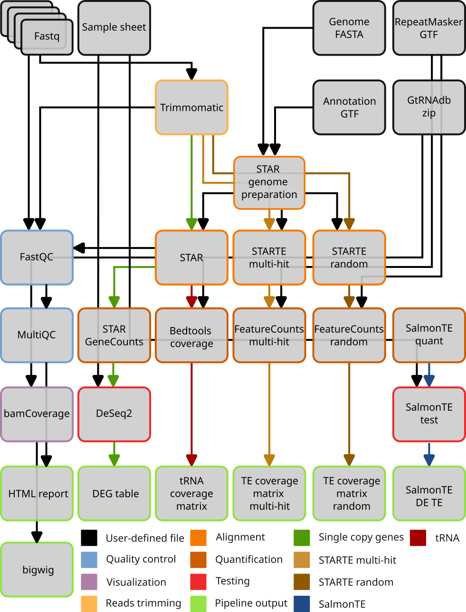

# 3t-seq: automatic gene expression analysis of single copy genes, transposable elements and tRNAs


## Overview

This is a Snakemake workflow for the end-to-end analysis of single copy genes, transposable elements and tRNAs. It performs standard quality control checks and genome alignment in three different ways specialized either for single copy genes or transposable elements. It then quantifies gene expression depending on how the alignement step was performed. Finally it performs differential gene expression analysis yielding lists of genes significantly deregulated between two given conditions.

<p align="center">

</p>

> [!IMPORTANT]
> **Upgrading from 1.x?** Version 2.0 changes the config file, the sample sheet and how the pipeline is installed and run. Follow the [migration guide](docs/migration/index.md) before re-using a 1.x project.

## Quickstart
3t-seq uses [Pixi](https://pixi.sh) to manage its dependencies automatically.

### 1. Prerequisites
- **Install Pixi**: If you haven't already, install Pixi by following the instructions on [pixi.sh](https://pixi.sh).
- **Clone the repository**:
   ```bash
   git clone https://github.com/boulardlab/3t-seq.git
   cd 3t-seq
   ```

> [!TIP]
> If you want the latest features or are contributing to the project, you can clone the `dev` branch directly:
> ```bash
> git clone -b dev https://github.com/boulardlab/3t-seq.git
> ```


### 2. Setup & Verification
Before running the pipeline or tests, ensure that Git LFS (Large File Storage) data is pulled:
```bash
pixi run -e dev setup
```
This command will install Git LFS in the local environment and pull the necessary test data.

### 3. Running the Pipeline
To verify your installation immediately with a small integration test:
```bash
pixi run -e dev test
```

## Requirements

- [Pixi](https://pixi.sh/) (Recommended for automated environment management)
- [Apptainer](https://apptainer.org/docs/user/latest/) (For containerized tool execution)

## Usage

### 1. Configure samples and parameters

Copy the commented template and fill it in, then write a sample sheet:

```bash
cp config/config.yaml config/my_config.yaml
```

The [`config/` folder](config/) contains a README with common patterns and a worked example in [`config/examples/`](config/examples/); the [Full Configuration Guide](docs/configuration/index.md) provides exhaustive details.

### 2. Execute the pipeline

Run the pipeline with the default local profile. The workflow has no built-in config file, so always pass `--configfile`:
```bash
pixi run snakemake --profile profile/default --configfile config/my_config.yaml
```

*Note: 3t-seq uses predefined environments (`default`, `dev`, `docs`). The `pixi run` command automatically handles all dependencies.*

### 3. Generate 3t-seq HTML report

After successful execution, generate an interactive HTML report:
```bash
pixi run snakemake --profile profile/default --configfile config/my_config.yaml --report report.zip
```

## Configuration

Adjust parameters in your config file to match your experimental setup. See [`config/README.md`](config/README.md) for further instructions.

### Automatic Resource Allocation

3t-seq automatically calculates the necessary computing resources (threads, memory, and runtime) based on the size of your input FASTQ files and the known requirements of tools like STAR and featureCounts.

- **Memory**: STAR is allocated base memory for the genome index (~32GB for mouse) plus dynamic memory for sorting proportional to input size.
- **Runtime**: Scaled linearly with the size of the compressed input reads.
- **Threads**: Optimized for different pipeline stages (8 threads for alignment, 4 for quantification).

### Custom Genome References

By default, references for `genome.label` (`mm10` or `mm39`) are downloaded automatically via Refgenie. To use your own FASTA and GTF files instead, keep the `label` and add `fasta_path`, `gtf_path` and `annotation_type` (all three are required together):

```yaml
genome:
  label: mm10
  fasta_path: /absolute/path/to/your/genome.fa
  gtf_path: /absolute/path/to/your/annotation.gtf
  annotation_type: ensembl # "ensembl", "gencode" or "mgi"
```

The pipeline will automatically apply necessary pre-processing to these files (like enforcing `chr` nomenclature and subsetting chromosomes) just like it does with Refgenie downloads. The `label` is still used to fetch the matching RepeatMasker and GtRNAdb annotations.

### Sample sheet preparation

The sample sheet is a csv file that describe samples metadata:

- The `name` column reports a human readable name for each sample.
- For paired-end libraries, `filename_1` and `filename_2` hold the paths to the two read mates; for single-end libraries, `filename` holds the path to the reads. Paths are absolute or relative to the Snakemake working directory, and the `.fastq.gz` / `.fq.gz` extension is optional.
- Whether a library is paired-end is set in the config, not in the sample sheet: add `protocol: pe` to each paired-end entry under `comparisons`.
- The `genotype` column reports the variable of interest. The name of this column is flexible and can be anything as long as you set it as `deseq2.variable` in the config file.


## Directory Structure

All outputs are written below `globals.results_folder`:

```text
<results_folder>/
├── qc/              FastQC and MultiQC reports
├── trim/            trimmed reads
├── alignments/      STAR (genes), deduplicated and STAR-TE alignments, TE counts and DESeq2
├── salmonTE/        SalmonTE quantification and differential expression
├── tRNA_coverage/   tRNA coverage, counts and DESeq2
├── analysis/        gene DESeq2 tables, R objects and datavzrd reports
├── references/      processed genome, annotations and indices
├── log/             job logs, one folder per run date
└── tmp/             scratch space
```

See [Results layout](docs/usage/index.md#results-layout) for the full tree.

## Run tests

The repository includes an integration test suite. You can run it using the pre-defined Pixi tasks:

```bash
# Run the integration test
pixi run -e dev test

# Generate a report for the test run
pixi run -e dev test-report
```

For more advanced testing options, see the [Usage documentation](docs/usage/index.md#pixi-tasks).

## References

Tabaro F, Boulard M, *3t-seq: automatic gene expression analysis of single copy genes, transposable elements and tRNAs from total RNA-seq data*, Under review.

## License

This project is licensed under the [MIT License](LICENSE).
