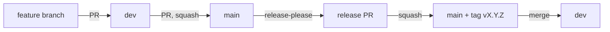

# Branches and PRs

## Branch model

The repository has two long-lived branches:

| Branch | Purpose |
| :--- | :--- |
| `dev` | The integration branch. All feature branches merge into `dev`. |
| `main` | The release branch. It changes only through a `dev` → `main` PR or a release PR. |

A change moves through these steps:



1. Create a feature branch from `dev`.
2. Open a PR from the feature branch to `dev`.
3. Merge the PR into `dev` when all checks pass.
4. To release, open a PR from `dev` to `main`. Squash-merge it.
5. Release-please opens a release PR on `main`. Merge it to create the `vX.Y.Z` git tag.
6. Merge `main` back into `dev`.

Steps 4 to 6 are in the [Release procedure](release.md).

## Feature branches

- Give the branch a short name with a type prefix: `feat/`, `fix/`, `docs/`, `ci/` or `chore/`.
  Add the issue number when there is one, for example `fix/20-21-lint-format`.
- Write commit messages as [Conventional Commits](https://www.conventionalcommits.org/).
  Release-please reads them to select the next version and to write the changelog.
- Refer to the issue in the commit message, for example `Refs #37`.
- Do not commit directly to `main`.

## PRs to `dev`

These workflows run on a PR to `dev`:
`lint.yml`, `test.yml` (job `smoke`), `container-check.yml`, and `build-3t-seq.yml` when the `Dockerfile` changes.
The [CI reference](ci.md) gives the details.

`dev` has no ruleset. GitHub does not block a merge into `dev` when a check fails.
Do not merge a PR into `dev` until all checks pass.
A failure on `dev` also blocks the next `dev` → `main` PR.

## Fork PRs

A fork PR has two limits:

- **Approval to run CI.** The repository setting is "Require approval for first-time contributors".
  A maintainer must approve the workflow runs of a first-time contributor.
- **No images.** `build-3t-seq.yml` skips fork PRs.
  `build-salmonte.yml` builds only for release PRs from this repository.
  A fork cannot push images to `ghcr.io/boulardlab`.

When a fork PR changes a conda env, the image for the new env hash does not exist.
Thus, the `check` job fails. To build the image, a maintainer does these steps:

1. Push the fork branch to a branch in `boulardlab/3t-seq`.
2. Run `gh workflow run build-3t-seq.yml --ref <branch>`.
3. Wait for the build to finish.
4. Run the failed `check` job of the fork PR again.

Alternatively, open a PR to `dev` from the branch in `boulardlab/3t-seq`.
That PR builds the image itself.

## Ruleset for `main`

The ruleset `main: release gate` protects `main`. It has these rules:

| Rule | Value |
| :--- | :--- |
| Target | The default branch (`main`) |
| Required checks | `check`, `dockerfile-sync`, `smoke` |
| Branch must be up to date | Yes (strict). The PR must contain the latest `main`. |
| Required approvals | 1 |
| Stale approvals | A new push to the PR removes the approvals. |
| Allowed merge methods | Squash and rebase. Merge commits are not allowed. |
| Branch deletion and force push | Blocked |
| Bypass | Repository admins, always |

To read the current rules, run:

```bash
gh api repos/boulardlab/3t-seq/rulesets
```

### Consequences

- **Squash `dev` → `main`.** `dev` contains merge commits.
  GitHub cannot rebase-merge a PR with merge commits, so squash is the only method for this PR.
- **One commit, one changelog entry.** Release-please sees the squash commit as one change.
  Put the release notes in the release PR. See [Release procedure](release.md).
- **Force the version with a footer.** End the squash commit message with `Release-As: X.Y.Z`.
  Release-please then proposes version `X.Y.Z`.
- **Approve from a different account.** GitHub does not let the author of a PR approve it.
  Ask a second maintainer to approve. Alternatively, an admin can bypass the rule.
- **Update before approval.** Update the branch first, then ask for approval.
  An update is a push, so it removes the approvals.
