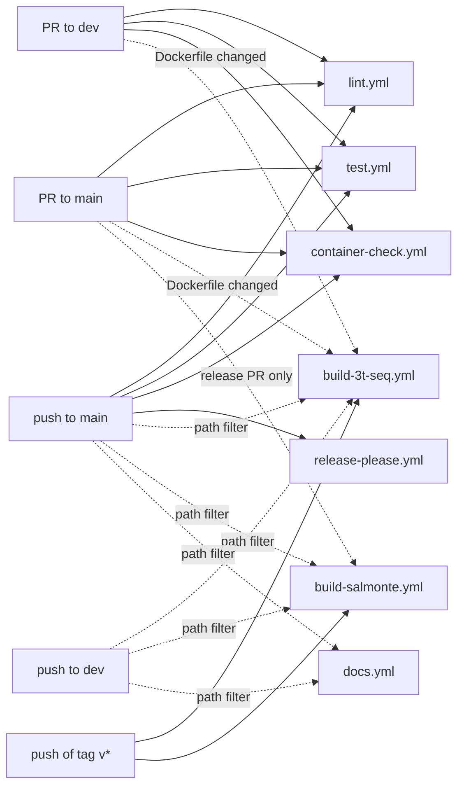

# CI reference

This page describes each workflow in `.github/workflows/`.
For each workflow, it gives the trigger, the jobs, the failures and the fixes.

## Events and workflows

A dashed arrow means that the workflow runs only when its condition is true.

| Workflow | PR to `dev` | PR to `main` | Push to `dev` | Push to `main` | Tag `v*` | Manual |
| :--- | :---: | :---: | :---: | :---: | :---: | :---: |
| `lint.yml` | Yes | Yes | No | Yes | No | No |
| `test.yml` | Yes | Yes | No | Yes | No | No |
| `container-check.yml` | Yes | Yes | No | Yes | No | Yes |
| `build-3t-seq.yml` | Path filter | Path filter | Path filter | Path filter | Yes | Yes |
| `build-salmonte.yml` | No | Release PR only | Path filter | Path filter | Yes | Yes |
| `release-please.yml` | No | No | No | Yes | No | No |
| `docs.yml` | No | No | Path filter | Path filter | No | Yes |

`test.yml` also calls `container-check.yml` as a reusable workflow (`workflow_call`).

!!! note
    `lint.yml` and `test.yml` run on PRs to `dev` after PR #27 merges. Before #27, they run only for `main`.

## Required checks

The ruleset for `main` requires three checks. See [Ruleset for `main`](branches.md#ruleset-for-main).

| Check | Workflow |
| :--- | :--- |
| `check` | `container-check.yml` |
| `dockerfile-sync` | `container-check.yml` |
| `run-integration-tests` | `test.yml` |

The reusable call in `test.yml` shows its jobs as `images / check` and `images / dockerfile-sync`.
These are the same jobs. The ruleset uses the jobs from the direct `container-check.yml` run.

## `lint.yml` (Format and lint)

| | |
| :--- | :--- |
| Trigger | PR to `main` or `dev`; push to `main` |
| Job | `lint` |
| Steps | `pixi run -e dev format-check`, then `pixi run -e dev lint` |

**Failures:**

- *`format-check` prints a diff.* `snakefmt` wants to change the formatting of a file in `workflow/`.
  Run `pixi run -e dev format`. Commit the changed files.
- *`lint` reports warnings.* `snakemake --lint` found a problem in a rule.
  Run `pixi run -e dev lint` on your computer. Correct each warning.

## `test.yml` (Run tests)

| | |
| :--- | :--- |
| Trigger | PR to `main` or `dev`; push to `main` |
| Jobs | `images` (calls `container-check.yml`), then `run-integration-tests` |
| Test | `pixi run -e dev test adaptive-trim laptop -- --singularity-args=...` |

`run-integration-tests` starts only after `images` passes.
It needs the pinned images, and on a PR the images can still be in the build.

The job also does these steps:

- It checks out the Git LFS test data.
- It sets `kernel.apparmor_restrict_unprivileged_userns=0`. Rootless Apptainer needs this on Ubuntu 24.04.

**Failures:**

- *`images` fails.* Read [`container-check.yml`](#container-checkyml-container-check).
- *A rule fails.* The `laptop` profile shows the log of the failed rule.
  Run `pixi run -e dev test adaptive-trim laptop` on your computer to reproduce it.
  See [Local checks](local-checks.md).
- *Pixi stops before Snakemake starts.* Read [Troubleshooting](troubleshooting.md).

## `container-check.yml` (Container check)

| | |
| :--- | :--- |
| Trigger | PR to `main` or `dev`; push to `main`; manual; `workflow_call` |
| Jobs | `dockerfile-sync` and `check`, in parallel |

### Job `dockerfile-sync`

1. It runs `pixi run containerize`.
2. It runs `git diff --exit-code -- Dockerfile workflow/Snakefile`.

**Failure:** *`git diff` shows a difference.*
A conda env changed, but the `Dockerfile` or the pin is old.
Run `pixi run containerize`. Commit `Dockerfile` and `workflow/Snakefile` together.

### Job `check`

1. It runs `container_pin.py check`. The pin in `workflow/Snakefile` must equal `env-<hash>` from the `Dockerfile`.
2. It runs `check-containers.sh`. All pinned images must have a fixed tag and must exist in `ghcr.io`.

On a PR, `check-containers.sh` waits for the build workflows of the PR head commit.
It checks the images every 60 seconds, for a maximum of 210 minutes.
It stops earlier when a build fails, or when no build runs after 3 minutes.
On a push to `main`, it checks one time and does not wait.

**Failures:**

| Message | Cause | Action |
| :--- | :--- | :--- |
| `pins ... but the Dockerfile needs env-...` | The pin and the `Dockerfile` do not agree. | Run `pixi run containerize`. Commit both files. |
| `mutable image refs` | A pin uses `:latest` or has no tag. | Pin `env-<hash>`, `X.Y.Z` or a digest. |
| `a build workflow failed for <sha>` | `build-3t-seq.yml` or `build-salmonte.yml` failed. | Correct the build. Run the failed jobs again. |
| `No build running for <sha>` and `missing images` | No workflow builds the pinned image. Example: a fork PR. | Build the image manually. See [Fork PRs](branches.md#fork-prs). |

## `build-3t-seq.yml` (Build 3t-seq)

| | |
| :--- | :--- |
| Trigger: PR | PR to `main` or `dev`, when `Dockerfile` or the workflow file changes |
| Trigger: push | Push to `main` or `dev`, with the same path filter; push of a `v*` tag |
| Trigger: manual | `workflow_dispatch` |
| Job | `docker` (skipped for fork PRs) |
| Platforms | `linux/amd64`, `linux/arm64` |

1. It reads the tag `env-<hash>` with `container_pin.py tag`.
2. If `env-<hash>` does not exist, it builds and pushes the image.
3. If `env-<hash>` exists, it adds the other tags to the existing image. It does not build.
4. On a `v*` tag, it adds the tag `X.Y.Z`, but only if `X.Y.Z` does not exist.

The [Containers](containers.md) page lists all tags.

**Failures:**

- *A conda env does not solve.* Most often, a package is missing for `linux/arm64`.
  Select a version that exists for both platforms. Run `pixi run containerize` again.
- *The build is slow.* The `arm64` build uses QEMU emulation. Wait for it to finish.

## `build-salmonte.yml` (Build SalmonTE)

| | |
| :--- | :--- |
| Trigger: PR | Release PR to `main` |
| Trigger: push | Push to `main` or `dev`, when `assets/docker/salmonTE/Dockerfile` or the workflow file changes; push of a `v*` tag |
| Trigger: manual | `workflow_dispatch`, with an optional `version` input |
| Job | `docker` (on PRs, only for `release-please--*` branches in this repository) |
| Platforms | `linux/amd64`, `linux/arm64` |

The workflow gets the version from these sources:

| Event | Version |
| :--- | :--- |
| Release PR | `.release-please-manifest.json` at the PR head |
| Manual | The `version` input |
| Tag `vX.Y.Z` | `X.Y.Z` |
| Push to a branch | None. It builds only branch tags. |

**Failures:**

| Message | Cause | Action |
| :--- | :--- | :--- |
| `invalid version` | The version is not `X.Y.Z`. | Give a version like `2.0.1`. |
| `vX.Y.Z is released and ... exists; refusing to overwrite` | A manual run or PR tried to replace a released image. | Do not replace released images. Release a new version. |
| `vX.Y.Z is already tagged; the release PR should propose a new version` | The release PR has the version of an existing git tag. | Correct `.release-please-manifest.json` or the `Release-As` footer. |

## `release-please.yml` (release-please)

| | |
| :--- | :--- |
| Trigger | Push to `main` |
| Job | `release-please` |
| Token | `RELEASE_PLEASE_TOKEN`; if the secret is empty, `GITHUB_TOKEN` |

- When `main` has new releasable commits, it opens or updates the release PR.
- When the release PR merges, it creates the git tag `vX.Y.Z` and a GitHub release.

Configuration: `release-please-config.json` and `.release-please-manifest.json`.
The `extra-files` are `pixi.toml` and `workflow/rules/salmonTE.smk`.

**Failures:**

- *`Bad credentials`.* The token expired, or its owner deleted it. See [Troubleshooting](troubleshooting.md#release-please-bad-credentials).
- *The release PR runs no checks.* The workflow used `GITHUB_TOKEN`.
  See [Troubleshooting](troubleshooting.md#release-pr-runs-no-checks).

The [Release procedure](release.md) gives the full steps.

## `docs.yml` (Docs)

| | |
| :--- | :--- |
| Trigger | Push to `main` or `dev` when `docs/`, `mkdocs.yml`, `pixi.toml` or the workflow file changes; manual |
| Jobs | `build` (`mkdocs build --clean --strict`), then `deploy` to GitHub Pages |

**Failure:** *`mkdocs build --strict` stops on a warning.*
Most often, a link is broken or a page is not in the `nav` of `mkdocs.yml`.
Run `pixi run -e docs docs-build` on your computer. Correct each warning.

!!! warning
    Pushes to `dev` and to `main` both deploy to the same GitHub Pages site.
    The site shows the last branch that CI deployed.

## Scripts

### `.github/scripts/container_pin.py`

Keeps the `containerized:` pin in `workflow/Snakefile` equal to the env hash in the `Dockerfile`.

| Command | Result |
| :--- | :--- |
| `python3 .github/scripts/container_pin.py tag` | Prints `env-<hash>` for the current `Dockerfile`. |
| `python3 .github/scripts/container_pin.py update` | Writes that tag into `workflow/Snakefile`. `pixi run containerize` runs this command. |
| `python3 .github/scripts/container_pin.py check` | Exits with 1 if the pin and the `Dockerfile` do not agree. |

### `.github/scripts/check-containers.sh`

Finds every `ghcr.io/boulardlab/*` image reference in `workflow/`. It skips comment lines.

| Option | Result |
| :--- | :--- |
| `--list` | Prints the references only. It does not access the registry. |
| `--wait-minutes N` | Waits up to `N` minutes for missing images. The default is 0 (check one time). |
| `--head-sha SHA` | Follows the build workflow runs for commit `SHA`. Needs `gh` and `GH_TOKEN`. |

The environment variable `GRACE_SECONDS` sets the time before the script looks for build runs. The default is 180.
