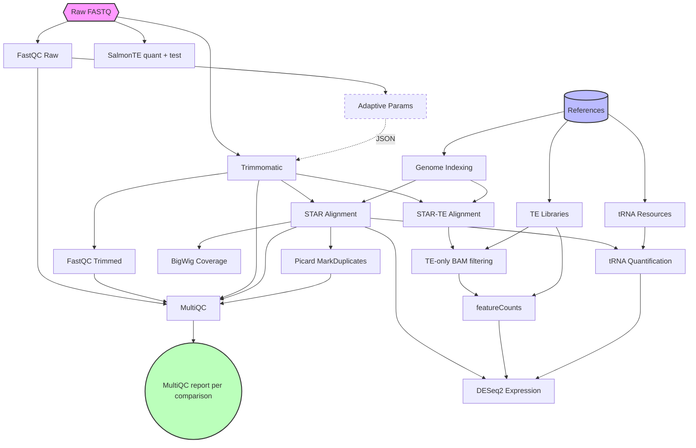

# 3t-seq Manual

Welcome to the **3t-seq** documentation.

3t-seq is a robust, automated Snakemake pipeline designed for end-to-end total RNA-seq analysis, with specialized modules for tRNA and transposable element (TE) processing.

## At a Glance

- **Easy to use**: Simplified configuration and environment management via [Pixi](https://pixi.sh).
- **Reproducible**: Container-native execution with Apptainer/Docker.
- **Comprehensive**: Handles everything from quality control to differential expression.
- **Scalable**: Runs on local machines or high-performance computing (HPC) clusters.

## Workflow Overview

`TRIM --> MULTIQC` stands for the Trimmomatic statistics; `STAR --> MULTIQC` for the STAR
logs, gene counts and FastQC of the STAR BAM; `MARKDUP --> MULTIQC` for the duplication
statistics and FastQC of the duplicate-marked BAM. SalmonTE uses the raw reads and the TE
index shipped in its container, and runs its own differential expression test. The
Snakemake HTML report is a separate step (see
[Running & Reporting](tutorial/running.md#2-detailed-reporting)).

## Navigation

- [Getting Started](getting-started/index.md): Installation and your first run.
- [Configuration](configuration/index.md): Detailed guide on how to set up your analysis.
- [Usage](usage/index.md): Commands and workflows.
- [Migrating from 1.x](migration/index.md): Config, sample sheet and environment changes in 2.0.
- [Deduplication](algorithms/deduplication.md): Understanding the deduplication strategy.
