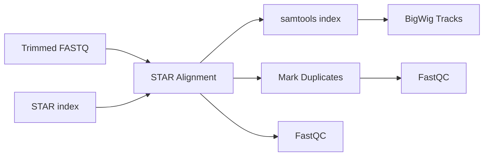

# Alignment

The alignment module maps trimmed reads to the reference genome with STAR, flags PCR
duplicates, and produces genome browser tracks.

## Workflow



The STAR index is built once per results folder; see
[Reference Management](references.md#star-index). The STAR BAM is also the input of
[tRNA quantification](trna-analysis.md); the TE alignments are a separate STAR run
([TE Analysis](te-analysis.md)).

## STAR Alignment

[STAR](https://github.com/alexdobin/STAR) is a fast, splice-aware RNA-seq aligner.

### Fixed options

Every run uses these options; they cannot be changed from the config:

| Option | Effect |
| :--- | :--- |
| `--quantMode TranscriptomeSAM GeneCounts` | Writes a transcriptome BAM and per-gene read counts (`ReadsPerGene.out.tab`, used for gene DESeq2). |
| `--outSAMtype BAM SortedByCoordinate` | Coordinate-sorted BAM, sorted by STAR itself. |
| `--twopassMode Basic` | Two-pass mapping for better splice-junction detection. |
| `--sjdbGTFfile <annotation>` | Gene annotation used at mapping time. |
| `--chimOutType WithinBAM` | Chimeric alignments in the main BAM. |
| `--outSAMunmapped Within`, `--outReadsUnmapped FastX` | Unmapped reads kept in the BAM and also written as FASTQ. |
| `--outWigType wiggle` | Signal tracks (`Signal.{Unique,UniqueMultiple}.str{1,2}.out.wig`). |

`outFilterMultimapNmax` is not set, so the STAR default (10) applies.

### Tunable options

The per-comparison `star` string is appended to the command. Default:

```text
--seedSearchStartLmax 30 --outFilterMismatchNoverReadLmax 0.04 --winAnchorMultimapNmax 40
```

Setting `star` replaces the whole default string, so repeat any of these options you want
to keep.

### Resources

Each STAR job uses 32 threads. Memory is 32 GB plus 4 GB per GB of compressed FASTQ input
(at least 5 GB), and runtime is 1 hour plus 1 hour per GB of input, multiplied by the
attempt number when Snakemake retries a job (`retries` in the profile).

The sorted BAM is indexed afterwards with `samtools index`.

## Duplicate Identification (Picard)

[Picard MarkDuplicates](https://broadinstitute.github.io/picard/) runs on the STAR sorted
BAM and **flags** PCR duplicates; it does not remove them (`REMOVE_DUPLICATES` is not
set). The duplicate-marked BAM and its metrics only feed FastQC and MultiQC; no
quantification step uses it.

## Coverage tracks (deepTools)

`bamCoverage` writes one bigWig per sample from the STAR sorted BAM. The per-comparison
`bamCoverage` string is appended to the command; default
`--binSize 50 --normalizeUsing None`. `--effectiveGenomeSize 2652783500` (mouse) is
fixed; it only matters if you choose `--normalizeUsing RPGC`.

## Parameters & Defaults

| Parameter | Default | Description |
| :--- | :--- | :--- |
| `star` | `--seedSearchStartLmax 30 --outFilterMismatchNoverReadLmax 0.04 --winAnchorMultimapNmax 40` | Extra STAR options, per comparison. |
| `bamCoverage` | `--binSize 50 --normalizeUsing None` | Extra bamCoverage options, per comparison. |

---

## Results

`results/` stands for `globals.results_folder`.

| Location | Description |
| :--- | :--- |
| `results/alignments/star/<comparison>/` | Per sample: `<sample>.Aligned.sortedByCoord.out.bam` and `.bai`, `Aligned.toTranscriptome.out.bam`, `ReadsPerGene.out.tab`, `SJ.out.tab`, four `Signal.*.wig` files, `Log.final.out`, and the bigWig `<sample>.bw`. The STAR files are symlinks into `alignments/star/_shared/<align_hash>/`. |
| `results/alignments/star_markdup/<comparison>/` | `<sample>.markdup.bam` and `<sample>.markdup.stats.txt` (symlinks into `_shared/`). |
| `results/qc/star/<comparison>/` | FastQC of the STAR sorted BAM. |
| `results/qc/fastqc-markdup/<comparison>/` | FastQC of the duplicate-marked BAM. |
