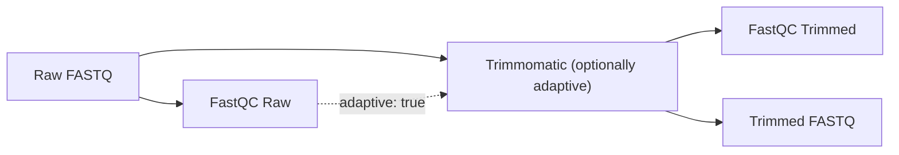

# Preprocessing

The preprocessing module ensures that sequencing data is of high quality and free from technical artifacts before alignment.

## Workflow



## Quality Control (FastQC)

The pipeline automatically executes [FastQC](https://www.bioinformatics.babraham.ac.uk/projects/fastqc/) on every raw fastq file.

- Results are stored in `results/qc/fastqc-raw/<comparison>/`.
- The reports go to MultiQC. Only with `trimmomatic.adaptive: true` are their metrics
  (adapter content, per-base quality, read length) also used to
  [derive the trimming steps](../algorithms/adaptive-trimming.md); otherwise they are
  QC only.

## Trimming (Trimmomatic)

[Trimmomatic](http://www.usadellab.org/cms/?page=trimmomatic) is used to remove adapters and low-quality bases.

`trimmomatic` is set per comparison and takes one of three forms. If it is omitted, the
built-in default runs: `ILLUMINACLIP:$CONDA_PREFIX/share/trimmomatic/adapters/TruSeq3-PE.fa:2:30:10 LEADING:3 TRAILING:3 SLIDINGWINDOW:4:15 MINLEN:36`
(`TruSeq3-SE.fa` for single-end libraries). The plain string `trimmomatic: default` is
the same as omitting the key, and `trimmomatic: adaptive` is short for
`{adaptive: true}`.

| Form | Example | Steps passed to Trimmomatic |
| :--- | :--- | :--- |
| Plain string | `trimmomatic: "ILLUMINACLIP:... CROP:50 MINLEN:36"` | Exactly the string, unchanged. Full control. |
| Object | `trimmomatic: {extra_params: "CROP:50"}` | Built-in default steps merged with `extra_params`. |
| Adaptive object | `trimmomatic: {adaptive: true, extra_params: "CROP:50"}` | Steps [derived from FastQC](../algorithms/adaptive-trimming.md) merged with `extra_params`. |

### How `extra_params` is merged

In both object forms, `extra_params` is merged into the base steps (default or derived):

- a step in `extra_params` replaces every base step of the same type
  (e.g. `SLIDINGWINDOW:4:25` replaces `SLIDINGWINDOW:4:15`);
- the result is ordered `ILLUMINACLIP` first, then the remaining base steps, then the
  other `extra_params` steps, then `MINLEN` last, so adapters are clipped on full-length
  reads and the length filter sees the final reads;
- if `CROP:N` is set and `MINLEN` comes from the base steps, `MINLEN` is lowered to N.
  Without this, a derived `MINLEN:52` (150 bp reads) and `CROP:50` would discard every read.
  A `MINLEN` you set yourself is never changed.

```yaml
comparisons:
  - name: Sample1
    trimmomatic:
      extra_params: "SLIDINGWINDOW:4:20 CROP:50"
# runs: ILLUMINACLIP:...TruSeq3-PE.fa:2:30:10 LEADING:3 TRAILING:3 SLIDINGWINDOW:4:20 CROP:50 MINLEN:36
```

!!! note "`CROP` only caps read length"
    `CROP:N` cuts reads longer than N down to N bases, from the 3' end. Reads that are
    already shorter than N keep their length; it does not make all reads the same length.

## Parameters & Defaults

| Parameter | Default | Description |
| :--- | :--- | :--- |
| `trimmomatic` | built-in default (above) | Plain step string, or an object with the keys below. |
| `trimmomatic.adaptive` | `false` | Enable [Adaptive Trimming](../algorithms/adaptive-trimming.md). |
| `trimmomatic.extra_params` | - | Trimmomatic steps merged into the default or derived steps (e.g. `CROP:100`). |

---

## Results

| Location | Description |
| :--- | :--- |
| `results/trim/<comparison>/` | Trimmed reads: `<sample>.fastq.gz` (se) or `<sample>_1.fastq.gz`, `<sample>_2.fastq.gz` and `<sample>_{1,2}.unpaired.fastq.gz` (pe), plus `<sample>.summary.txt` and `<sample>.stats.txt`. These are symlinks into `_shared/`. |
| `results/trim/_shared/<trim_hash>/` | The actual files, shared by identical samples across comparisons, and `<sample>.adaptive_params.json` in adaptive mode (see [Deduplication](../algorithms/deduplication.md)). |
| `results/qc/fastqc-raw/<comparison>/` | FastQC of the raw reads: `<sample>_raw_fastqc.{html,zip}` (se) or `<sample>_raw_1_fastqc.*`, `<sample>_raw_2_fastqc.*` (pe). |
| `results/qc/fastqc-trimmed/<comparison>/` | FastQC of the trimmed reads: `<sample>_trimmed_fastqc.*` (se) or `<sample>_trimmed_1_fastqc.*`, `<sample>_trimmed_2_fastqc.*` (pe). |

`results/` stands for `globals.results_folder`.
