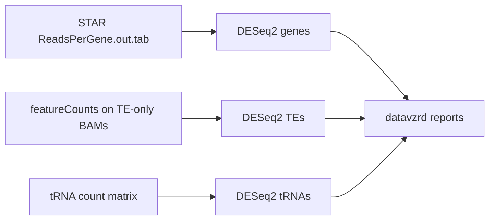

# Quantification & Differential Expression

The Quantification & DE module provides statistical assessment of gene, TE, and tRNA expression differences across experimental conditions.

## Overview

Differential expression analysis identifies transcripts that change significantly between biological groups, providing insights into biological processes and molecular mechanisms.

## Workflow



## Gene Quantification (STAR)

Gene counts come from STAR itself (`--quantMode GeneCounts`, see [Alignment](alignment.md)):
the gene DESeq2 step reads each sample's `ReadsPerGene.out.tab`. No separate counting
tool runs for genes.

!!! note "Strandedness"
    The gene DESeq2 step uses column 2 of `ReadsPerGene.out.tab` (unstranded counts)
    whatever `strandedness` is set to. `strandedness` is currently only passed to
    featureCounts for the STAR-TE counts.

[featureCounts](https://subread.sourceforge.net/featureCounts.html) (Subread 2.1.1) is
only used for TEs; see [TE Analysis](te-analysis.md). tRNA counts are described in
[tRNA Analysis](trna-analysis.md).

## Differential Expression (DESeq2)

[DESeq2](https://bioconductor.org/packages/release/bioc/html/DESeq2.html) is a leading Bioconductor package for differential expression analysis.

### Model

For single-copy genes (`workflow/scripts/deseq2_v1.R`):

- **Filtering**: genes with a total count not above the number of samples are dropped.
- **Design**: `~ <variable>`, with `reference_level` as the base level of the factor.
- **Test**: `Wald` (default), or `LRT` against the reduced model `~ 1`.
- **Results**: `results()` for the first non-intercept coefficient (`results.csv`), and
  log2 fold changes shrunk with `lfcShrink(type = "apeglm")` (`results.shrink.csv`).
- **Normalization**: DESeq2's size factors correct for library size.

### Result Visualization

The datavzrd report of each DESeq2 run shows the results table with:

- **Volcano Plots**: Highlight significantly changing genes.
- **MA Plots**: Visualize the relationship between expression level and fold change.

## Parameters & Defaults

Each value is taken from the comparison (`comparisons[].deseq2`), then from
`defaults.deseq2`, then from the schema default. The same settings apply to the gene, TE
and tRNA DESeq2 runs and to SalmonTE.

| Parameter | Default | Description |
| :--- | :--- | :--- |
| `deseq2.test` | `Wald` | Statistical test (`Wald` or `LRT`). |
| `deseq2.variable` | `genotype` | The column in the sample sheet to use for analysis. |
| `deseq2.reference_level` | none, **required** | The baseline level of the `variable` (e.g., `WT`). |

`reference_level` has no default. A comparison without it, in its own `deseq2` or in
`defaults.deseq2`, is rejected at start-up:

```text
Invalid config file:
  comparisons '<name>': deseq2.reference_level is not set. Set it to the control level of deseq2.variable, under 'defaults.deseq2' or in the comparison's 'deseq2'.
```

---

## Results

| Location | Description |
| :--- | :--- |
| `results/analysis/tables/deseq2/<comparison>/` | Gene DESeq2 results (`results.csv`, `results.shrink.csv`). |
| `results/analysis/rdata/deseq2/<comparison>/` | Gene DESeq2 object (`dds.rds`). |
| `results/analysis/datavzrd/<comparison>/` | Interactive gene results report. |
| `results/qc/multiqc/<comparison>/multiqc_report.html` | MultiQC report of the comparison. |

TE and tRNA results are written next to their quantification; see
[Results layout](../usage/index.md#results-layout).
