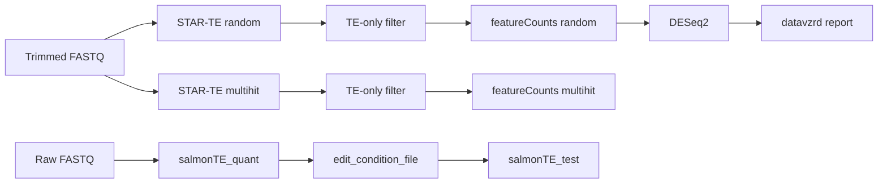

# Transposable Element (TE) Analysis

The Transposable Element module quantifies TE expression with two independent methods:
STAR-TE (genome alignment + RepeatMasker counting) and SalmonTE (quasi-mapping to TE
consensus sequences).

## Overview

Transposable elements are highly repetitive, making them challenging to quantify. The 3t-seq pipeline addresses this with specialized alignment and quantification strategies.

## Workflow

## Methods

### STAR-TE

Trimmed reads are aligned twice with STAR against the genome index, without splicing
(`--alignIntronMax 1`, `--alignEndsType EndToEnd`, up to 3 mismatches). Alignments that
overlap a RepeatMasker element are kept (`samtools view -L` with the RepeatMasker BED) and
counted per repeat name (`featureCounts -g repName` on the RepeatMasker GTF, Subread
2.1.1).

- **Random**: STAR keeps reads with up to `outFilterMultimapNmax` (default 5000) loci,
  reports one of them chosen at random (`--outMultimapperOrder Random --outSAMmultNmax 1`),
  and featureCounts counts it (`-p -M`). Each read is counted once.
- **Multihit**: STAR reports all loci of reads with up to `outFilterMultimapNmax` loci, and
  featureCounts splits each multi-mapping read across them (`-p -M --fraction`: each locus
  gets 1/n). With the default `outFilterMultimapNmax: 1` only uniquely mapping reads are
  kept, so the fractional counting has no effect unless you raise it.

Only the **random** counts go on to DESeq2 and the datavzrd report; the multihit counts
table is written but not tested.

### SalmonTE Analysis

[SalmonTE](https://github.com/hyunhwan-bcm/SalmonTE) is a fast and accurate quantification method for TE transcripts.

- Uses quasi-mapping to quickly assign reads to a curated database of TE consensus sequences.
- Runs on the raw FASTQ files, with the TE index shipped in the
  `ghcr.io/boulardlab/3t-seq/salmonte:<version>` container.
- `salmonTE_quant` quantifies, `edit_condition_file` writes the sample groups into
  SalmonTE's `condition.csv`, and `salmonTE_test` runs SalmonTE's own differential
  expression test.

SalmonTE's differential expression uses the same grouping as DESeq2: samples whose
`deseq2.variable` column equals `deseq2.reference_level` are `control`, all others are
`treatment`. Other sample sheet columns are ignored, so any column name (including
`condition`) is allowed.

SalmonTE has TE indexes for mouse, human, zebrafish and fruit fly only, chosen from the
first two letters of `genome.label`. For any other label it is skipped with a warning; see
[SalmonTE supported genomes](../configuration/index.md#salmonte-supported-genomes).

### Turning the methods off

- `disable_TE_analysis: true` skips STAR-TE (alignment, featureCounts, DESeq2, report).
- `disable_salmonTE_analysis: true` skips SalmonTE.

The two flags are independent. STAR-TE needs the RepeatMasker annotation, which is only
fetched for `mm10`/`mm39`; any other genome requires `disable_TE_analysis: true`.

## Parameters & Defaults

Set them under `defaults` for all comparisons, or per comparison under the comparison
entry (the comparison value wins, key by key).

### `starTE_random`

| Parameter | Default | Description |
| :--- | :--- | :--- |
| `outFilterMultimapNmax` | `5000` | Maximum number of loci a read may map to. |
| `winAnchorMultimapNmax` | `5000` | Maximum number of loci an anchor may map to. |
| `alignTranscriptsPerWindowNmax` | `300` | Maximum number of alignments per window. |

### `starTE_multihit`

| Parameter | Default | Description |
| :--- | :--- | :--- |
| `outFilterMultimapNmax` | `1` | Maximum number of loci a read may map to (1 = unique only). |
| `winAnchorMultimapNmax` | `5000` | Maximum number of loci an anchor may map to. |
| `alignTranscriptsPerWindowNmax` | `3000` | Maximum number of alignments per window. |

The other STAR and featureCounts options, including `--fraction` for multihit, are fixed.

---

## Results

`results/` stands for `globals.results_folder`.

| Location | Description |
| :--- | :--- |
| `results/alignments/starTE/<comparison>/{random,multihit}/` | STAR-TE alignments (`<sample>.Aligned.out.bam`, `Log.final.out`), symlinks into `starTE/_shared/<starte_hash>/`. |
| `results/alignments/starTE/<comparison>/filter/{random,multihit}/` | TE-only BAMs (`<sample>.TEonly.bam`). |
| `results/alignments/starTE/<comparison>/featureCount/` | Count tables `random.txt` and `multihit.txt`. |
| `results/alignments/starTE/<comparison>/DESeq2/` | TE differential expression for random mode (`lfc.csv`, `dds_random.rds`). |
| `results/alignments/starTE/<comparison>/random/datavzrd/` | Interactive TE results report (random mode). |
| `results/salmonTE/quant/<comparison>/` | SalmonTE quantification (`EXPR.csv`, `MAPPING_INFO.csv`, `clades.csv`, `condition.csv`). |
| `results/salmonTE/de_analysis/<comparison>/` | SalmonTE differential expression results and plots. |
