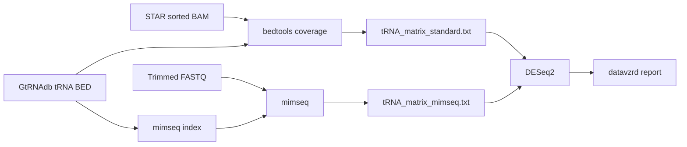

# tRNA Analysis

The tRNA Analysis module quantifies tRNA genes and tests them for differential expression.

## Overview

tRNA genes are densely modified and highly repetitive, requiring specialized alignment strategies to avoid mapping biases.

## Workflow

Only one branch runs, selected by `tRNA_quantification.method`.

## tRNA Quantification

### `standard` (default)

Reads from the STAR genome alignment ([Alignment](alignment.md)) are counted over the
GtRNAdb tRNA gene coordinates with `bedtools coverage`, one BED per sample, and the
results are combined into a count matrix.

### `mim-tRNA-seq` (opt-in)

With `method: mim-tRNA-seq` the pipeline runs
[mim-tRNA-seq](https://github.com/nedialkova-lab/mim-tRNAseq) instead: it builds a
mimseq index from the genome FASTA and the GtRNAdb annotation (clustering tRNAs at
`cluster_identity`), aligns the trimmed reads of each sample with `mimseq`, and merges
the per-sample cluster counts into a matrix. Use it only for libraries prepared with the
mim-tRNA-seq protocol.

### Differential expression

The count matrix goes to DESeq2 with the comparison's `deseq2.variable` and
`deseq2.reference_level` (see [Quantification & DE](quantification-de.md)), and the
results to an interactive datavzrd report.

### tRNA Annotation

The pipeline uses annotations from [GtRNAdb](http://gtrnadb.ucsc.edu/), which are highly
curated and provide detailed information on tRNA isoacceptors and isodecoders. They are
downloaded automatically for `mm10` and `mm39` only; any other genome requires
`disable_tRNA_analysis: true` (see [Reference Management](references.md)).

Set `disable_tRNA_analysis: true` to skip the module.

## Parameters & Defaults

| Parameter | Default | Description |
| :--- | :--- | :--- |
| `tRNA_quantification.method` | `standard` | `standard` or `mim-tRNA-seq`. |
| `tRNA_quantification.mimseq_params.max_mismatches` | see below | `mimseq --max-mismatches`. |
| `tRNA_quantification.mimseq_params.cluster_identity` | see below | `mimseq --cluster-id`, applied when the index is built. |
| `tRNA_quantification.mimseq_params.min_cov` | `10` | `mimseq --min-cov`. |

The `mimseq_params` defaults currently depend on whether the block is present: without
it the run uses `max_mismatches: 0.1` and `cluster_identity: 0.95`; with it (even empty)
missing keys get `2` and `0.8`. See the
[configuration reference](../configuration/index.md#expert-parameters) and set the
values explicitly.

---

## Results

`results/` stands for `globals.results_folder`; `<method>` is `standard` or `mimseq`.

| Location | Description |
| :--- | :--- |
| `results/tRNA_coverage/<comparison>/<sample>.bed` | Per-sample tRNA coverage (`standard`). |
| `results/tRNA_coverage/mimseq_<comparison>/<sample>/` | Per-sample mimseq output (`mim-tRNA-seq`). |
| `results/tRNA_coverage/<comparison>/tRNA_matrix_<method>.txt` | Count matrix. |
| `results/tRNA_coverage/<comparison>/tRNA_dds_<method>.rds` | DESeq2 object. |
| `results/tRNA_coverage/<comparison>/tRNA_lfc_<method>.csv` | DESeq2 results. |
| `results/tRNA_coverage/<comparison>/datavzrd_<method>/` | Interactive report. |
| `results/references/gtrnadb/` | Downloaded tRNA annotations; the mimseq index goes to `mimseq_index/` here. |
